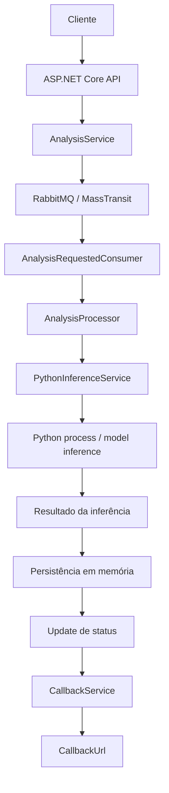

# PlantDiseaseAI

Backend ASP.NET Core para receber imagens de plantas, enfileirar análises, executar inferência de IA em Python e notificar o sistema solicitante por callback HTTP.

## Visão geral

O projeto é um serviço de processamento assíncrono de imagens para classificação de doenças em plantas. O backend em C# é responsável por:

- receber a imagem via HTTP;
- validar e armazenar a imagem localmente;
- criar um registro de análise;
- publicar a requisição em RabbitMQ usando MassTransit;
- processar a análise em segundo plano;
- executar a inferência por meio de um processo Python;
- persistir o resultado em memória;
- atualizar o status da análise;
- enviar o resultado ou o erro para o `CallbackUrl` informado.

A comunicação com o módulo Python não acontece como uma API separada exposta ao cliente. O C# executa um processo Python controlado e interpreta a resposta JSON retornada pela inferência.

## Arquitetura



A estrutura refletida no código inclui a API ASP.NET Core, a camada de aplicação, a fila RabbitMQ, o consumidor, a orquestração da análise e o callback HTTP.

## Tecnologias

| Tecnologia | Uso no projeto |
|---|---|
| C# / ASP.NET Core | API HTTP, orquestração da aplicação e processamento da análise. |
| .NET 8 | Target framework do projeto. |
| Swagger / Swashbuckle | Documentação interativa da API em ambiente de desenvolvimento. |
| RabbitMQ | Mensageria assíncrona para enfileirar análises. |
| MassTransit | Abstração para publicação/consumo de mensagens sobre RabbitMQ. |
| Python | Execução do módulo de inferência e classificação de imagens. |
| Sistema de arquivos local | Armazenamento das imagens em `Uploads`. |
| `HttpClient` | Envio do callback HTTP para o solicitante. |
| xUnit | Testes automatizados do projeto. |

## Estrutura do projeto

```text
PlantAiMonitor/
├── AI/
│   ├── Configuration/
│   ├── Inference/
│   ├── Interfaces/
│   ├── Models/
│   ├── Pipeline/
│   ├── Postprocessing/
│   └── Preprocessing/
├── Application/
│   ├── Configuration/
│   ├── Interfaces/
│   └── Services/
├── Common/
├── Contracts/
│   ├── Commands/
│   └── Events/
├── Controllers/
├── DTOs/
│   ├── Requests/
│   └── Responses/
├── Extensions/
├── Infrastructure/
│   ├── Repositories/
│   ├── Queue/
│   └── Storage/
├── Messaging/
│   ├── Configuration/
│   ├── Consumers/
│   ├── Extensions/
│   └── Publishers/
├── Models/
├── Properties/
├── Uploads/
├── appsettings.json
├── appsettings.Development.json
├── Program.cs
├── PlantAiMonitor.csproj
├── PlantAiMonitor.csproj.user
└── PlantAiMonitor.http
```

Principais responsabilidades por pasta:

- `Controllers`: expõe os endpoints HTTP da API.
- `Application`: orquestração do fluxo de análise e serviços de domínio/aplicação.
- `AI`: integração com o módulo Python, pipeline de inferência e modelos relacionados.
- `Contracts`: comandos e eventos usados na mensageria.
- `DTOs`: payloads de entrada e resposta da API.
- `Infrastructure`: repositórios, fila e armazenamento local.
- `Messaging`: configuração, publicação e consumo de mensagens via MassTransit.
- `Models`: entidades de domínio e estruturas de resultado.
- `Extensions`: registro de serviços e configurações no contêiner de DI.
- `Uploads`: diretório local usado para salvar imagens recebidas.

## Fluxo de análise

O fluxo real implementado no projeto é o seguinte:

1. O cliente envia uma imagem para o endpoint `POST /analysis`.
2. O `AnalysisController` recebe a requisição.
3. O `AnalysisService` valida a imagem e salva o arquivo em `Uploads`.
4. É criado um `AnalysisJob` com `Id`, `CorrelationId`, `RequesterId`, `SourceSystem`, `CallbackUrl`, `ImageReference`, `Metadata`, `Status` e timestamps.
5. O `AnalysisService` publica um `AnalysisRequestedCommand` via `IMessagePublisher`.
6. A mensagem é entregue ao `AnalysisRequestedConsumer` por meio de RabbitMQ + MassTransit.
7. O `AnalysisRequestedConsumer` chama `AnalysisProcessor.ProcessAsync`.
8. O `AnalysisProcessor` atualiza o status para `Processing`.
9. A análise executa a pipeline em `AnalysisPipeline`, que chama a inferência por meio de `PythonInferenceService`.
10. O processo Python recebe a imagem e retorna um payload JSON.
11. O resultado é convertido para `PredictionResult` e persistido no repositório em memória.
12. O status da análise é atualizado para `Completed`.
13. O `CallbackService` envia um POST para o `CallbackUrl` com o resultado da análise ou com o erro, conforme o caso.

## API

### Endpoint: criar análise

- Método: `POST`
- Rota: `/analysis`
- Finalidade: receber uma imagem e enfileirar a análise.
- Body: `multipart/form-data`

Campos esperados no request:

```json
{
  "requesterId": "usuario-123",
  "sourceSystem": "mobile-app",
  "callbackUrl": "https://exemplo.com/callback",
  "metadata": {
    "campo": "valor"
  },
  "image": "arquivo de imagem"
}
```

O `CreateAnalysisRequest` do projeto contém:

- `RequesterId`
- `SourceSystem`
- `CallbackUrl`
- `Image`
- `Metadata`

Resposta de sucesso:

```json
{
  "analysisId": "8f40a6d7-2208-4d20-b2d5-114f1093d152",
  "status": "Queued"
}
```

Se a imagem estiver vazia ou ausente, o serviço dispara `InvalidImageException` e a API retorna `400 Bad Request`.

### Endpoint: consultar status

- Método: `GET`
- Rota: `/analysis/{id}`
- Finalidade: consultar o status atual da análise.

Resposta esperada:

```json
{
  "analysisId": "8f40a6d7-2208-4d20-b2d5-114f1093d152",
  "status": "Completed",
  "createdAt": "2026-08-17T12:00:00Z",
  "startedAt": "2026-08-17T12:00:05Z",
  "finishedAt": "2026-08-17T12:00:12Z",
  "imageReference": "Uploads/93c7d29a-abc1-45d3-a4b4-d4f9d4d2a4ef.jpg"
}
```

### Endpoint: consultar resultado

- Método: `GET`
- Rota: `/analysis/result/{id}`
- Finalidade: obter a última análise concluída.

Resposta esperada:

```json
{
  "analysisId": "8f40a6d7-2208-4d20-b2d5-114f1093d152",
  "status": "Completed",
  "imageReference": "Uploads/93c7d29a-abc1-45d3-a4b4-d4f9d4d2a4ef.jpg",
  "createdAt": "2026-08-17T12:00:00Z",
  "startedAt": "2026-08-17T12:00:05Z",
  "finishedAt": "2026-08-17T12:00:12Z",
  "predictedClassId": 2,
  "predictedClass": "rose_R02",
  "disease": "rose_R02",
  "confidence": 0.5133,
  "description": "",
  "probabilities": {
    "mildew": 0.3734,
    "rose_P01": 0.1133,
    "rose_R02": 0.5133
  },
  "predictions": []
}
```

Os endpoints são expostos pelo `AnalysisController` e o mapeamento é definido via `[Route("analysis")]`.

## Análise assíncrona

O projeto usa mensageria assíncrona para não bloquear a requisição HTTP. A sequência real é:

- `AnalysisService` recebe a imagem;
- cria `AnalysisJob`;
- publica `AnalysisRequestedCommand`;
- `AnalysisRequestedConsumer` ouve a fila;
- `AnalysisProcessor` executa o processamento pesado;
- a fila e o consumidor fazem a orquestração da tarefa em segundo plano.

Isso é implementado com:

- `AnalysisRequestedCommand`
- `IMessagePublisher`
- `MessagePublisher`
- `AnalysisRequestedConsumer`
- `MassTransit`
- `RabbitMqOptions`
- `MassTransitConfiguration`

A aplicação envia mensagens para o broker configurado em `appsettings.json` e consome a fila informada pela chave `RabbitMq:QueueName`.

## Inferência de IA

### Integração C# → Python

A integração é feita por `PythonInferenceService`, responsável por:

- validar a existência da imagem;
- resolver o caminho do script Python;
- resolver o caminho do checkpoint;
- chamar o executor Python;
- deserializar o JSON emitido pela inferência;
- retornar um objeto de Resultado para o restante da aplicação.

O arquivo de configuração que controla a inferência está em `appsettings.json` com as chaves:

- `PythonInference:PythonExecutablePath`
- `PythonInference:PythonProjectRoot`
- `PythonInference:InferenceScriptPath`
- `PythonInference:CheckpointPath`
- `PythonInference:ModelName`
- `PythonInference:TimeoutSeconds`

O projeto não expõe uma API Python separada para o cliente. A parte em Python é tratada como um subprocesso invocado pelo C#.

## Resultado da análise

Os modelos reais do domínio incluem:

- `AnalysisJob`
- `PredictionResult`
- `DiseasePrediction`
- `AnalysisStatus`

`PredictionResult` contém campos como:

- `ImageReference`
- `PredictedClassId`
- `PredictedClass`
- `Disease`
- `Confidence`
- `Description`
- `ModelVersion`
- `ProcessedAt`
- `Predictions`
- `Probabilities`

`DiseasePrediction` representa uma previsão individual com:

- `DiseaseId`
- `Disease`
- `Confidence`
- `Probability`

O enum `AnalysisStatus` possui os valores reais do projeto:

```csharp
Pending = 0
Queued = 1
Processing = 2
Completed = 3
Failed = 4
```

## Callback

O callback é implementado por `CallbackService` e registrado via DI.

### Quando o callback é enviado

- após o processamento bem-sucedido e persistência do resultado; e
- em falhas de processamento, quando o `AnalysisProcessor` captura a exceção e marca a análise como falha.

### Payload de sucesso

O callback de sucesso envia um JSON com:

```json
{
  "analysisId": "8f40a6d7-2208-4d20-b2d5-114f1093d152",
  "status": "Completed",
  "predictedClassId": 2,
  "predictedClass": "rose_R02",
  "confidence": 0.5133,
  "probabilities": {
    "mildew": 0.3734,
    "rose_P01": 0.1133,
    "rose_R02": 0.5133
  },
  "imageReference": "Uploads/93c7d29a-abc1-45d3-a4b4-d4f9d4d2a4ef.jpg"
}
```

### Payload de falha

```json
{
  "analysisId": "8f40a6d7-2208-4d20-b2d5-114f1093d152",
  "status": "Failed",
  "error": "mensagem do erro"
}
```

### Regras reais implementadas

- usa `POST`;
- usa `Content-Type: application/json`;
- usa `HttpClient` via DI;
- usa timeout configurado em `Callback:TimeoutSeconds`;
- ignora o callback se `CallbackUrl` estiver vazio;
- registra warning/error quando o callback retorna 4xx, 5xx, timeout ou falha de conexão;
- falha no callback não reverte uma análise concluída para `Failed`.

## Configuração

O arquivo principal de configuração é `appsettings.json`.

### RabbitMQ

```json
"RabbitMq": {
  "Host": "localhost",
  "Port": 5672,
  "Username": "guest",
  "Password": "guest",
  "VirtualHost": "/",
  "QueueName": "plant-disease-ai.queue"
}
```

### Python / inferência

```json
"PythonInference": {
  "PythonExecutablePath": "python",
  "PythonProjectRoot": "..\\..\\..\\..\\Python\\PlantDiseaseTraining",
  "InferenceScriptPath": "inference\\inference_cli.py",
  "CheckpointPath": "checkpoints\\best_model.pt",
  "ModelName": "efficientnet_b0",
  "TimeoutSeconds": 60
}
```

### Callback

```json
"Callback": {
  "TimeoutSeconds": 10
}
```

`appsettings.Development.json` contém apenas configuração de logging e não inclui credenciais adicionais.

## Execução local

Pré-requisitos reais confirmados pelo projeto:

- .NET 8 SDK;
- RabbitMQ local em `localhost:5672`;
- Python disponível no `PATH` (configurado com `PythonExecutablePath = "python"`);
- módulo Python do projeto apontado por `PythonProjectRoot`.

Comando para restaurar dependências:

```powershell
dotnet restore
```

Comando para compilar:

```powershell
dotnet build
```

Comando para executar o backend:

```powershell
dotnet run
```

Para usar o perfil de execução com HTTP/HTTPS configurado em `launchSettings.json`:

```powershell
dotnet run --launch-profile http
```

## Testes

O projeto possui testes em `PlantAiMonitor.Tests`.

Os testes existentes incluem:

- `PythonInferenceServiceTests`
- `CallbackServiceTests`

Comando para executar todos os testes:

```powershell
dotnet test
```

Os testes do projeto foram validados no ambiente atual e a suíte passou com sucesso no comando executado.

## Exemplo de fluxo completo

```text
POST /analysis
      ↓
AnalysisService
      ↓
AnalysisJob
      ↓
RabbitMQ / MassTransit
      ↓
AnalysisRequestedConsumer
      ↓
AnalysisProcessor
      ↓
PythonInferenceService
      ↓
Python inference process
      ↓
PredictionResult
      ↓
Completed
      ↓
CallbackService
      ↓
POST CallbackUrl
```

## Status atual

O backend possui as partes principais implementadas e funcionando no código atual:

- API HTTP com endpoints de criação, consulta de status e consulta de resultado;
- camada de serviços e orquestração de análise;
- fila assíncrona com RabbitMQ e MassTransit;
- integração com processo Python para inferência de imagens;
- armazenamento local de imagens em `Uploads`;
- persistência em memória da análise;
- callback HTTP para sucesso e falha;
- testes automatizados cobrindo inferência e callback.

## Observações

- O projeto usa repositório em memória (`InMemoryAnalysisRepository`), então os dados não são persistidos entre reinicializações do processo.
- O callback é uma notificação complementar; a análise pode continuar concluída mesmo quando o callback falha.
- O backend depende de um broker RabbitMQ acessível em `localhost:5672` para o processamento assíncrono funcionar corretamente.
- O módulo Python é parte do fluxo de inferência, mas não é exposto como uma API separada para o cliente.
